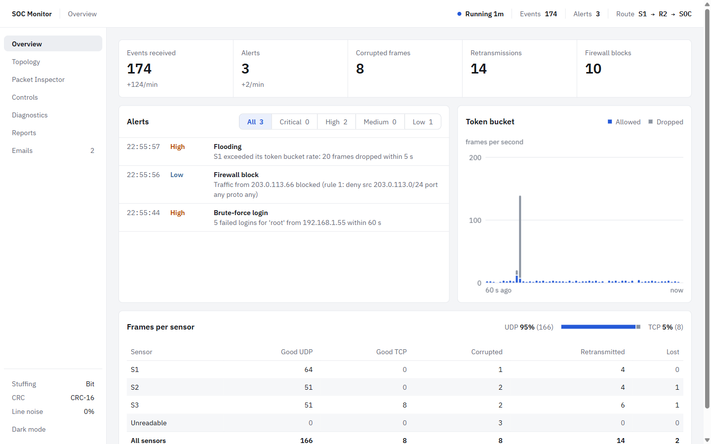
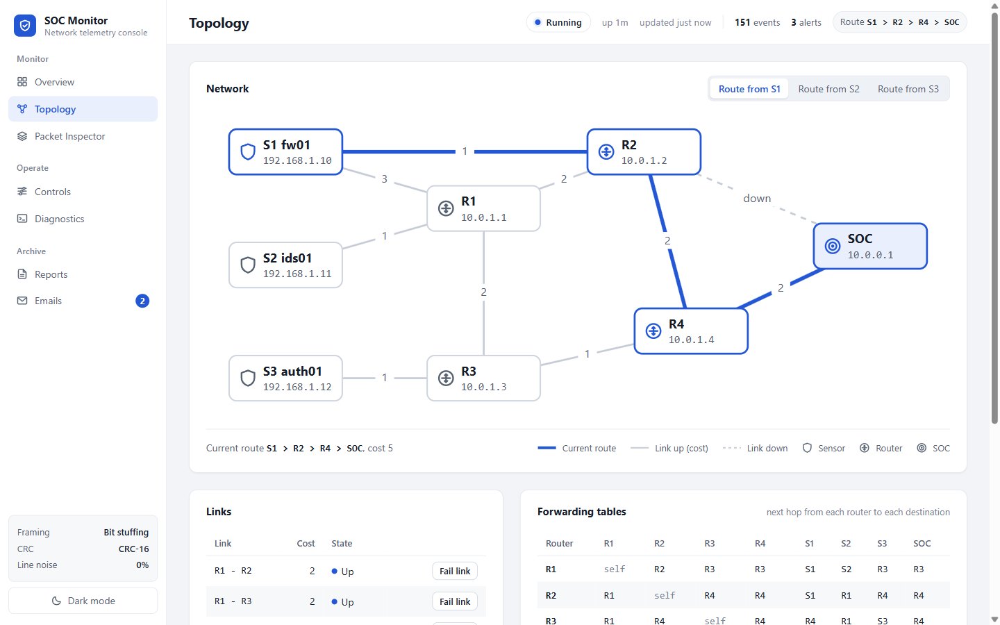
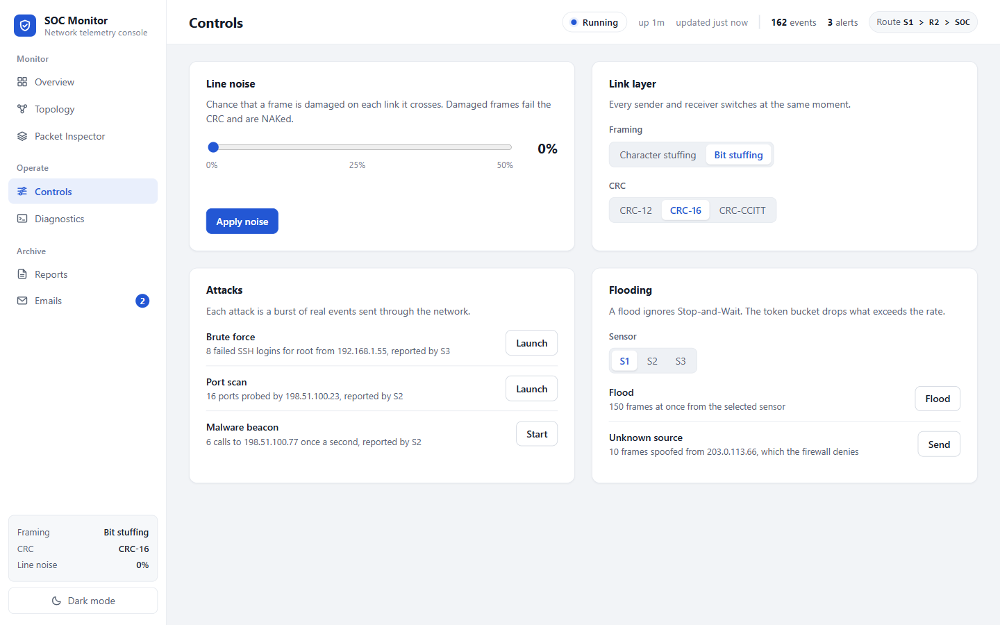
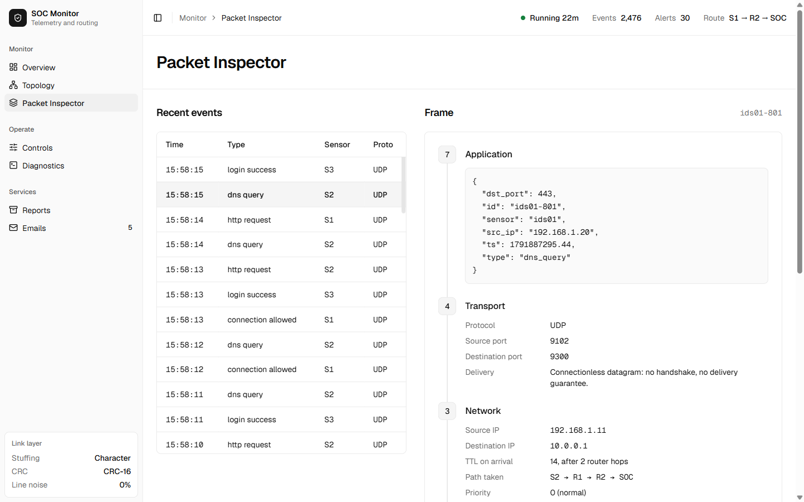
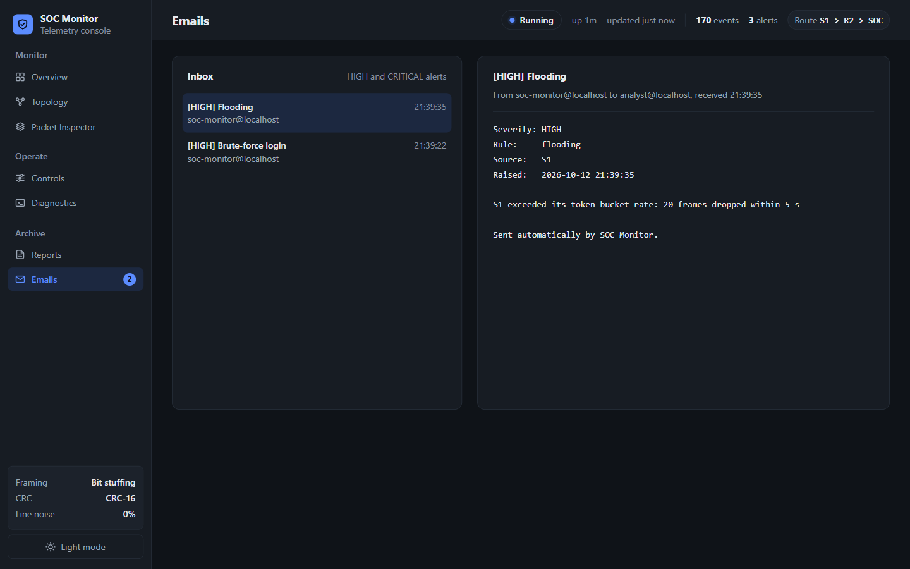
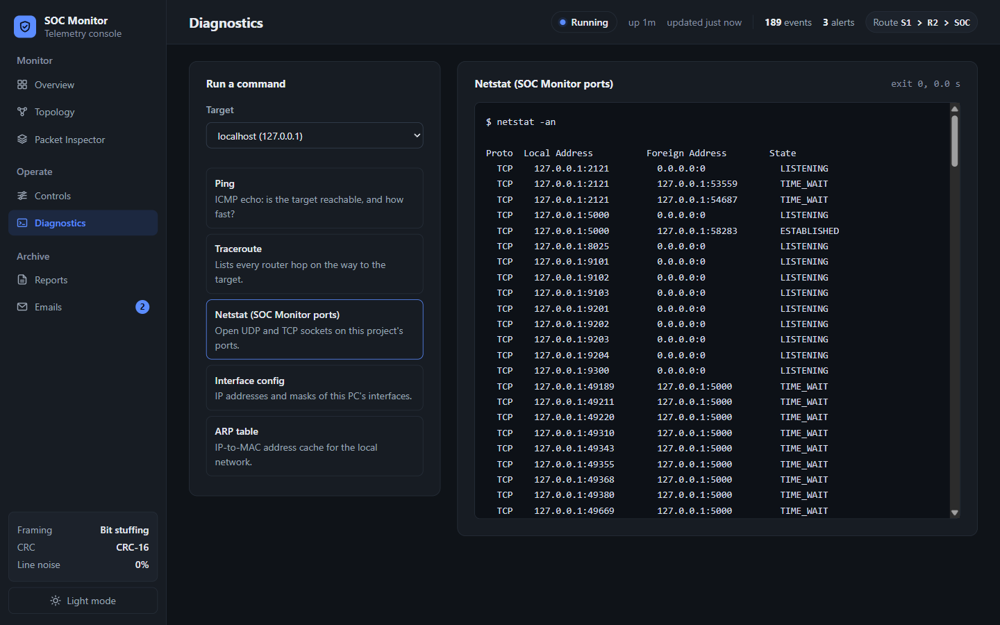
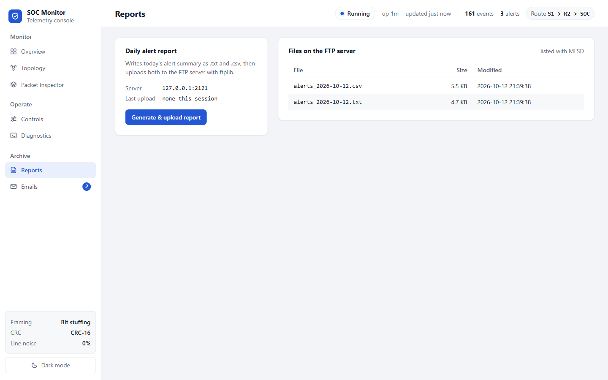

# SOC Monitor

A small Security Operations Center that runs as a real network on one PC (or two).
Three simulated sensors (a firewall, an IDS and an auth server) turn security events
into data link frames and send them over real UDP and TCP sockets through four routers
to a central SOC collector. Along the way the project demonstrates:

- **Framing**: character stuffing and bit stuffing between flags.
- **Error detection**: CRC-12, CRC-16 and CRC-CCITT by binary polynomial division.
- **Reliable delivery**: Stop-and-Wait ARQ with ACK, NAK, timeout and retransmission.
- **Routing**: Dijkstra shortest paths. When a link fails, traffic is rerouted automatically.
- **Security**: an ACL firewall, a token bucket against flooding, and detection rules
  for brute force, port scans, unknown hosts, malware C2 beacons and link tampering.
- **Application services**: alert emails over SMTP, daily reports over FTP, and ping,
  traceroute, netstat, ipconfig and arp diagnostics.

Everything is shown on a live web dashboard built with plain HTML, CSS and JavaScript.
It works offline: no CDN and no frontend libraries.

## Architecture

```
  Sensors (end hosts)           Routers (Dijkstra forwarding)             SOC
 +----------------+
 | S1 fw01        |--1--------------------------+
 | 192.168.1.10   |                             |
 +----------------+--3--+                  +---------+          +--------------------+
                         |                 |   R2    |----1-----|  Collector  :9300  |
 +----------------+    +---------+---2-----|10.0.1.2 |          |  CRC check, ARQ    |
 | S2 ids01       |-1--|   R1    |         +---------+          |  firewall (ACL)    |
 | 192.168.1.11   |    |10.0.1.1 |              |               |  token bucket      |
 +----------------+    +---------+              2               |  detector          |
                            |                   |               +--------------------+
                            2              +---------+                |   |   |
 +----------------+    +---------+         |   R4    |----2-----------+   |   |
 | S3 auth01      |-1--|   R3    |----1----|10.0.1.4 |                    |   |
 | 192.168.1.12   |    |10.0.1.3 |         +---------+         alerts.jsonl  |   |
 +----------------+    +---------+                                 |      |   |
                                                    SMTP :8025 <---+      |   +--> Dashboard :5000
                                                    FTP  :2121 <--- reports    (Flask, JSON polled 1/s)

  Frame on every link:  FLAG | HEADER | PAYLOAD (event JSON) | CRC | FLAG
  Routine events -> UDP.  HIGH / CRITICAL events -> TCP.  ACK/NAK travel back the same way.
```

The numbers on the links are the link costs from `config.json`. Each node is a real
socket server on its own port. A sensor sends a frame to its first-hop router, and every
router decrements the TTL, recomputes the CRC and forwards the frame to its next hop.
The collector checks the frame and answers with an ACK or a NAK.

## Setup

You need Python 3.10 or newer. The only third-party packages are `flask`, `pyftpdlib`
and `aiosmtpd`. From the `soc-monitor/` folder:

```powershell
uv venv
.venv\Scripts\activate          # Linux: source .venv/bin/activate
uv pip install -r requirements.txt
```

Without `uv`, `python -m venv .venv` and `pip install -r requirements.txt` work too.

## Running on one PC

```powershell
python run_demo.py              # add --noise 0.1 to start with line noise, --verbose for every hop
```

The console prints a short banner, one line per service, and the current routes. Then
open <http://127.0.0.1:5000>. **Ctrl+C** stops every service cleanly. Detailed logs
(every hop, ACK, NAK, timeout and retransmission) go to `logs/soc-monitor.log`, and
alerts go to `logs/alerts.jsonl`.

## Running on two PCs

All addresses live in `config.json`. Each node has a `host_ip` (the real address its
socket binds to) and a `sim_ip` (the logical address written in frames). To split the
network across two lab PCs, edit only the `host_ip` values:

1. Find each PC's address with `ipconfig` (Windows) or `ip addr` (Linux), for example
   PC A `192.168.0.21` and PC B `192.168.0.22`.
2. In `config.json`, set `host_ip` to `192.168.0.21` for the sensors S1–S3, and to
   `192.168.0.22` for R1–R4 and SOC. Copy the same file to both PCs.
3. Allow the ports through the firewall on both PCs (UDP and TCP 9101–9103 and
   9201–9300).
4. Run `python run_demo.py` on both PCs. Each PC starts only the nodes whose `host_ip`
   it owns. The PC that hosts the SOC also starts the dashboard, FTP and SMTP. Open the
   dashboard on PC B.

Settings changed in the dashboard (failed links, framing method, CRC type, noise) apply
to the nodes on the dashboard's PC. In two-PC mode, change the framing method and CRC
type in `config.json` on both PCs rather than in the dashboard, so that both sides keep
encoding frames the same way. Two things stay on the sensors' PC:

- The retransmitted and lost counters are counted by the sensors, so they appear in
  the sensors' PC log rather than on the dashboard.
- The attack and flood buttons drive sensors in the same process, so with the sensors
  on PC A they answer "runs on the other PC". For the full 7-step demo, run everything
  on one PC. Use the two-PC setup to show real frames crossing the lab network.

## Demo (3–4 minutes)

| Step | Where | What to do | What you see |
|---|---|---|---|
| 1 | Topology | Start `run_demo.py` and open the dashboard. | Events flow. The route S1 > R2 > SOC is highlighted. |
| 2 | Controls | Click **Launch brute force**. | A HIGH "Brute-force login" alert on Overview, and an email in **Emails**. |
| 3 | Controls | Set noise to 15% and click **Apply noise**. | Corrupted frames and retransmissions climb, and a "Link tampering or noise" alert appears. Set noise back to 0%. |
| 4 | Topology | Click **Fail link** on R2 - SOC. | Dijkstra reroutes S1 over R2 > R4 > SOC, and the highlight moves. Click **Restore link**. |
| 5 | Controls | Click **Flood from sensor** (S1), then **Send from unknown IP**. | The token bucket chart shows drops and a HIGH "Flooding" alert. Firewall blocks rise and a LOW "Firewall block" alert names 203.0.113.66. |
| 6 | Reports | Click **Generate & upload report**. | Today's `.txt` and `.csv` appear in the FTP file list. |
| 7 | Diagnostics, Packet Inspector | Run **Ping** and **Netstat**. Then pick an event in **Packet Inspector**. | Real command output. The event shown layer by layer: JSON, UDP/TCP ports, IPs and path, then header, CRC and the stuffed frame in hex and binary. |

**Launch port scan** and **Start malware beacon** trigger the port scan (plus unknown
host) and malware C2 rules. Switching **Character stuffing / Bit stuffing** and the CRC
type in Controls takes effect immediately for every node.

If the live demo breaks, `python -m network.routing`, `python -m datalink.frame`,
`python -m datalink.experiment` and `python -m services.ftp_archive` each show their
part on the console.

## Tests

```powershell
python -m unittest discover -s tests -v
```

The 148 tests cover every module: stuffing round trips, CRC detection, ARQ with a
scripted fake link, detector thresholds, firewall order, token bucket, the dashboard
API, FTP upload, SMTP delivery, and end-to-end runs over real sockets on shifted ports,
so a running demo is not disturbed.

## Experiment results

`python -m datalink.experiment` sends 1000 random frames per error pattern and writes
two CSV files to `results/`:

- `crc_detection.csv`: all three CRCs detected 100% of 1-, 2- and 3-bit errors and of
  bursts of 12 and 24 bits. That is what theory predicts, since odd and short-burst
  errors are always caught, and a longer burst escapes only with probability 2^-r.
- `stuffing_overhead.csv`: on random bytes, character stuffing costs about 0.8% and bit
  stuffing about 1.6%. On event JSON, character stuffing costs more (about 1.0%),
  because every closing `}` (0x7D) is the ESC byte and must be escaped. Bit stuffing
  costs only about 0.5%, because ASCII text rarely contains five 1s in a row.

## Project structure

```
soc-monitor/
  run_demo.py            start/stop everything, startup banner
  config.json            nodes, links, ports, CRC/framing, firewall, token buckets
  config_loader.py       the one way to read config.json
  datalink/              framing.py (stuffing), crc.py, frame.py (frame format),
                         arq.py (Stop-and-Wait), experiment.py (CSV results)
  network/               topology.py, routing.py (Dijkstra), transport.py (UDP/TCP),
                         node.py (forwarding + noisy links), router.py
  soc/                   events.py, sensor.py, collector.py, detector.py,
                         firewall.py, qos.py (token bucket), state.py, system.py
  services/              ftp_archive.py, mailer.py, diagnostics.py
  dashboard/             app.py (JSON API), inspector.py, templates/, static/
  tests/                 unittest suite
  results/               experiment CSVs
  logs/ reports/ ftp_root/   created at run time
  SYLLABUS_MAP.md        concept -> file -> function -> dashboard tab
```

Lab code: no original lab files were provided in `lab_code/`. The framing, CRC and
Dijkstra modules are therefore clean textbook-style implementations (Forouzan).

## Screenshots

| | |
|---|---|
|  |  |
| Overview: stat tiles, live alerts, token bucket chart | Topology: R2-SOC failed, route moved to R2 > R4 > SOC |
|  |  |
| Controls: noise, link layer, attacks, flooding | Packet Inspector: one event at every layer |
|  |  |
| Emails (dark mode): alert inbox | Diagnostics (dark mode): netstat of the SOC ports |
|  | |
| Reports: files on the FTP server | |
